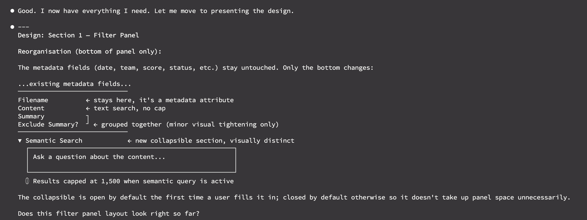
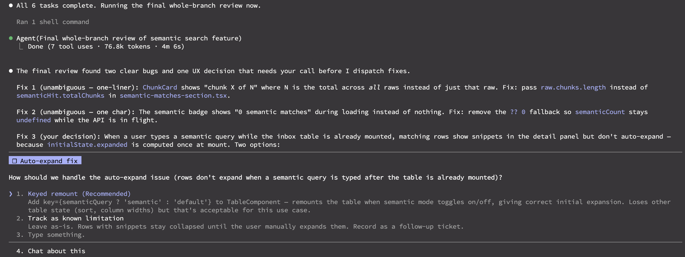
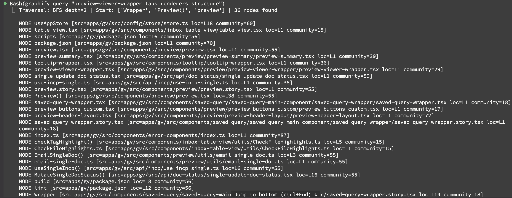

<details>
  <summary>Own Raw Notes</summary>

# V. raw prompt (common across tools as starting point)

I want to make changes to current gv app by including another type of search which is the "semantic search". Current ways of searching include metadata searching through fields like "date created" and content search such as fields like "Content". However, for "Semantic Search", it is at chunk-level, while the current documents in the search results are considered to be in a container level. The hierarchy can be thought of as "container (highest)", then "document (such as attachment or root email in container)", and "chunk (snippet in a document)". A container can have multiple documents hence multiple chunks.

So i am trying to see:

1. how the search result listing and the detailed panel (right panel) will look like.
2. how the different search can gel together
3. Also, because "semantic search" can only return up to 1500 results, while the current search returns up to 10,000 results.

# Superpowers

## Brainstorming

### Flow

1. Started to ask questions in a logical way
2. After clarifying, then start generating design in markdown to clarify
3. After clarifying, then start generatings specs in separate files
4. After confirming, git add & commit
5. After committing, then run `spec: self-review`

- This seems to be more for checking what's left out than checking against its output with what was discussed?

6. Then starts to generate a single implementation plan with various tasks
7. Then asked if want to sub-agent driven development (fresh state automatically) / inline execution
8. <SDD>

- Separate agents do task-by-task
  - Implement > Review task

### Observations

1. Gave options, but when listed constraints and asked which one better, it proposes and then just went with it
2. Really just about "clarifying" — but doesn't seem very proactive (e.g.: could ask if want to reorganise the search filter?) But after I asked to review it, it did propose a few and added some considerations
   (e.g.: muscle memory from users on the layout)
3. Even after preferences, there are still some cases where it made it's own decision, e.g: after stating a concern:

```
Easy mitigation — cap the Snippets tab at the top 3–5 most relevant chunks, with a "Show X more" link below. Keeps the tab scannable without hiding depth.

I think I have enough to propose approaches now. Let me move to that.
```

```
All four sections confirmed. Writing the design doc now.
```

4. Design section is shown in this format? Not sure how scalable (how much tokens?) and effective if design gets complicated
   

5. Seems quite in agreement easily

- Initially proposed certain way in Design plan, then after questioning why there's xxx, then it immediately said "Fair Challenge...Seeing it concretely now,..."

6. Seems very naiive

- e.g.: Keyword in my prompt saying "it's for explaining why relevant", then the label becomes "Why relevant" without considering things like low score

7. Doesn't retain some instructions/comments well

- e.g.: Mentioned that "Filename field" is not considered content search, which it acknowledges but when generating the design spec out, it still says "content search (keyword matching in Content, Summary, Filename fields)"
  - Ended up it has its own conflict, the bottom section says "Filename stays with metadata fields — it is a file attribute, not a content search."

8. Implementation plan generated after the design specs, is quite detailed with the task breakdown (+checkboxes)

- Hard to verify / visualize esp. if big projects OR for newer officers who don't know the structure —> but could be a process thing where should get familiarise with the codebase first
- Upon briefly reading, caught a "naiive" mistake that there were 2 tests consecutively on the same thing but the checkbox for first was fail then second passed with no changes in code

9. (to verify) After implementation plan generated out, it asked if i ok. Idk if it was because i closed the file of the plan or clicked something else, it treated as "rejected"

10. (to verify) After selecting sub-agent driven development, it created `.superpowers/sdd` then copied over the task 1 brief over?? — not sure if this takes up tokens etc. and how accurate

11. There's even a part on whole-branch-review by itself, which asked for more inputs on ambiguity areas
    
12. Towards the end after finishing the task, it says to "I'm using a finishing-a-development-branch skill" to complete this work

```
Bash(GIT_DIR=$(cd "$(git rev-parse --git-dir)" 2>/dev/null && pwd -P)
  GIT_COMMON=$(cd "$(git rev-parse --git-common-dir)" 2>/dev/null && pwd -P)
  echo "GIT_DIR: $GIT_DIR"
  echo "GIT_COMMON: $GIT_COMMON"
  echo "Branch: $(git branch --show-current)"
  echo "Base: $(git merge-base HEAD main)")
```

- Had to be careful and reject such operations

13. After the task was "finished", tried to test and found some issues

- It then proposed some changes, but just edited codes and did not update the specs
- Upon asking it to update specs, it only went on to update based on the completed tasks, like changing status & refining "Follow-up" but not about the workaround (i.e. update mock logic) in the specs

14. Issues persisted after prompting ~3 times on the issue and how it says "fixed", but issue still remained

## Others

- In between conversations (during superpowers), said to ask next time before going, it stores in memory
  `/Users/qingru/.claude/projects/-Users-qingru-Documents-workspace-Projects-gee-vee-two/memory/MEMORY.md`

# SpecKit

## Setup

1. Specify init

- Allows merging & overriding to initialise
  - Created skills within current directory (`./.claude/skills/*`)

2. Run `/specify-constitution`

- Auto extract from Claude.md and project structure

## Flow

1. After setup, then start with `/speckit-specify`

- Input a prompt, then it started to generate out a detailed specs without further clarifications

2. (CORRECTION: there's a `/speckit-clarify` which is supposed to generate structured questions on the feature spec)

## Observations

1. It doesn't ask for permissions & commit after constitution. It just says "Suggested commit message ..."
2. Doesn't clarify much in `/speckit-specify`, only minimal points that are marked as `NEEDS CLARIFICATION` after generating a detailed plan already

- Even during clarification, i asked "what is ur recommendation?" then it went on to say "Option B...<explanation>` then just went ahead to update spec and said "Shout if you want a different Q2 choice", <proceeds to generate more>
  - Clarifications are 1 whole bunch where we need to answer manually ourselves like "Question 1 - <option>..."
    - But in `/speckit-specify` it is question by question

- `/speckit-specify` supposed to be: create basedline specification

3. During `/speckit-clarify`, it updated the specs with a specific clarifications section with the session date, question and response
   - May not be able to digest so easily
   - It will end with showing a table again on the different categories (e.g.: "Functional scope & success criteria") then show "Status" — whether "Clear", "Resolved" (which are questions that came out in this segment, to resolve these ambiguities)
   - Afterwards, it will say "No Outstanding or Deferred items block planning. Suggested next command: /speckit-plan"

# Claude

## Observations

1. Graphify helps??
   

## General

1. When to know whether it's time to clean up conversation?

- Seems to "auto-compact"? —> based on the CLI says "x% to auto-compact"
- Symptoms:
  - Cross-topic confusion
  - Post-correction persistence — the "you're right" trap

2. How to pinpoint directly the part in the generated spec that needs changes without wasting too much tokens to describe where/risk changing the wrong part?

3. How much to actually read through the Specs OVER just let it run and see the result before delving into specs??

</details>

_Summarised my notes using AI_

# Comparing SpecKit & Superpowers

## Task: Adding Semantic Search to GV App

**Brief:** Add chunk-level semantic search alongside existing metadata/content search (container-level). Need to figure out: result listing & detail panel UX, how search types coexist, and handling the 1,500 vs 10,000 result cap mismatch.

---

## Tool: Obra Superpowers

### Flow

1. Clarifying questions → 2. Design doc (markdown) → 3. Spec files → 4. Git commit → 5. `spec: self-review` → 6. Implementation plan (tasks) → 7. Choice of sub-agent-driven dev vs. inline execution

### What worked

- Detailed, checkbox-style implementation plans
- Self-review step catches gaps (more "what's missing" than "does this match what we discussed")
- Pushed back constructively once challenged — reconsidered design when asked "why xxx?"
- Branch-review step proactively flagged ambiguous areas before wrap-up

### What didn't

- **Not proactive on judgment calls.** Rarely suggested alternatives (e.g., reorganizing search filters) unless explicitly asked to review.
- **Agrees too readily.** Tends to converge on a single approach quickly rather than holding tension between options.
- **Naive labeling.** Picks up surface keywords too literally — e.g., calling something "Why relevant" without accounting for edge cases like low relevance scores.
- **Inconsistent instruction retention.** Acknowledged "Filename is not content search" mid-conversation, but the generated spec still listed Filename under content search in one place and correctly excluded it in another — self-contradictory output.
- **Spec drift after code changes.** When fixing issues post-implementation, it updated code but not specs. Asked to sync specs — it updated task status/follow-ups but missed the actual logic change (e.g., a mock workaround).
- **Unverified "fixed" claims.** After ~3 rounds of "this is fixed," the issue persisted. Unclear what verification it actually ran (unit test vs. real integration check, e.g. via Playwright) — needs investigation.
- **Caught a real bug in its own plan**: two near-identical test checkboxes, one marked fail → next marked pass with no code change in between.
- **Needs supervision on git/bash operations** — at one point ran toward a "finish branch" workflow that needed to be manually stopped.
- Ambiguous on plan approval — closing a plan file or clicking away may register as "rejected" (unconfirmed).

### Open questions

- How much should specs be read in detail vs. just running and checking results?
- Token/scalability concerns for the visual "design diagram" format it uses — untested at scale.
- How sub-agent task handoff actually works under the hood (token cost, accuracy) — unconfirmed.

---

## Tool: SpecKit

### Flow

1. `specify init` → scaffolds `.claude/skills/`
2. `/specify-constitution` — auto-extracts from CLAUDE.md/project structure
3. `/speckit-specify` — generates detailed spec from a prompt
4. `/speckit-clarify` — structured clarification questions (separate command, easy to miss)
5. `/speckit-plan` (next step, not yet explored)

### What worked

- `/speckit-clarify` keeps a clear audit trail: session date, question, response, all in spec
- Ends each clarification round with a status table (Clear / Resolved) — easy to see what's settled before moving to planning

### What didn't

- **Minimal upfront clarification.** `/speckit-specify` jumps to a detailed spec with only a few inline `NEEDS CLARIFICATION` flags — doesn't probe deeply before generating.
- **Recommends, then runs.** Asked for its recommendation, it would propose an option, explain it, immediately apply it to the spec, then just note "shout if you want something different" — easy to miss the chance to push back.
- **No permission step for commits** — just states a suggested commit message rather than asking.
- **Clarification answer format is bulkier** than expected — one large batch of Q&A to fill in manually, vs. the more conversational one-at-a-time style elsewhere.

### Open questions

- Have not yet tested `/speckit-plan` or beyond.

---

## General Observations (Across Tools)

- **Context management matters.** Long sessions risk auto-compaction, which shows up as cross-topic confusion and a "you're right" pattern of over-agreeing after correction (even when not warranted).
- **Precision in feedback is hard.** Hard to point at _exactly_ the part of a spec to change without (a) burning tokens over-describing location, or (b) risking it editing the wrong section.
- **Spec vs. output trust.** Still calibrating how much to read specs/plans line-by-line vs. trusting the run and checking results — especially for larger projects or less-familiar codebases.
- **Self-correction looks convincing but isn't always correct.** Confident "fixed"/"that's right" language doesn't always mean the underlying issue is resolved — needs independent verification, not just re-asking.
