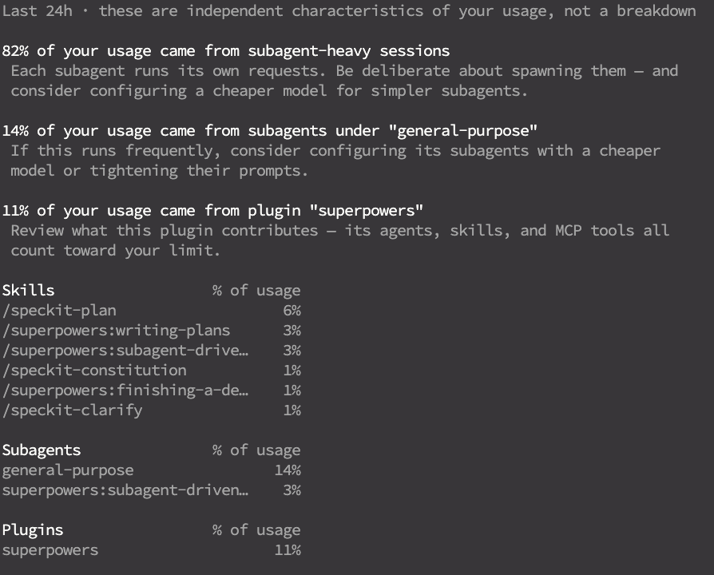

# AI-Assisted Coding Weekly Journal

> **Project / Task(s): Incorporating semantic search into GV app (filter form, result listing, detail panel)**

---

# 1. Weekly Summary

## What did you work on?

- Comparing Spec Tools — SpecKit & Superpowers
- Generating UI ideas with the use of Claude Design

## AI tools / models / workflows used

- Tool(s): Superpowers, SpecKit, Claude Design
- Model(s): Mainly Sonnet 4.6, a bit of Haiku 4.5
  - Approximation:
    - Sonnet 4.6 (94.3%): In: 5.2k · Out: 826.9k
    - Haiku 4.5 (5.7%): In: 1.4k · Out: 49.3k
- Skills / Templates / Artifacts used:
  - Superpowers
  - SpecKit
  - Claude Design
- Approximate AI usage:
  - ☐ Rarely (<20%)
  - ☐ Occasionally (20–50%)
  - ☐ Frequently (50–80%)
  - x AI-first (>80%)

---

# 2. AI Usage Reflection

Rate AI's usefulness for the activities you performed this week.

| Activity                    | Didn't Use | ★☆☆☆☆ | ★★☆☆☆ | ★★★☆☆ | ★★★★☆ | ★★★★★ | Notes                                                  |
| --------------------------- | ---------- | ----- | ----- | ----- | ----- | ----- | ------------------------------------------------------ |
| Understanding existing code | ☐          | ☐     | ☐     | x     | ☐     | ☐     | Seems to hallucinate a bit just based on keywords      |
| Requirement clarification   | ☐          | ☐     | ☐     | x     | ☐     | ☐     |                                                        |
| Planning / decomposition    | ☐          | ☐     | ☐     | x     | ☐     | ☐     |                                                        |
| Implementation              | ☐          | ☐     | x     | ☐     | ☐     | ☐     | But impacted by planning which needs more delving into |
| Test generation             | ☐          | ☐     | ☐     | ☐     | ☐     | ☐     |                                                        |
| Debugging                   | ☐          | ☐     | ☐     | ☐     | ☐     | ☐     |                                                        |
| Code review                 | ☐          | ☐     | ☐     | ☐     | ☐     | ☐     |                                                        |
| Documentation               | ☐          | ☐     | ☐     | ☐     | ☐     | ☐     |                                                        |

---

# 3. Effective Practices

## Was there a workflow or process you consistently used?

Examples:

- Read → Plan → Code
- Spec → Tasks → Code → Review
- TDD
- Review after every implementation
- etc.

**Workflow**

- **Why did it work?**

-

Would you recommend others to try it?

- ☐ Yes
- ☐ Maybe
- ☐ No

---

# 4. Biggest Win

What was the highest-value use of AI this week?

- Generating options for a particular feature
- Brainstorming pros & cons of options
- Kickstart planning of implementation

# 5. Biggest Friction

What slowed you down?

Check all that apply.

- x AI misunderstood the requirement
- x Hallucinated implementation
- x Large / complex codebase
- ☐ Context window limitation
- ☐ Unsure what prompt to use
- ☐ Unsure what workflow to use
- ☐ Missing documentation
- ☐ Internal / air-gapped limitation
- ☐ Tool limitation
- ☐ Model limitation
- ☐ Other

Describe briefly:

-

# 6. New Things Explored

Did you intentionally try anything new this week?

Examples:

- Prompting technique
- New Skill
- Spec-driven workflow
- Multi-agent workflow
- New model
- Artifact
- Review technique

What did you try?

- More indepth specs/brainstorming with Superpowers & SpecKit

Would you use it again?

- ☐ Yes
- x Maybe
- ☐ No

Why?

- Pretty time consuming & needs more figuring out where the CG should be. How much to review the specs, and whether to use some images as part of the planning phase

# 7. Organizational Insights

## Should anything become standardized?

Check all that apply.

- ☐ Prompt
- ☐ Workflow
- ☐ Skill
- ☐ Template
- ☐ Artifact
- ☐ Checklist
- ☐ Coding guideline
- x Nothing this week

Describe:

-

## What guidance did you wish existed?

Examples:

- Which model to use?

- When to create a design document?

- How much planning is enough?

- How to manage context?

## Did you encounter anything that would have benefited from Internet-only tooling?

Examples:

- MCP server
- Data API
- Documentation access
- External search
- Other integrations

Describe:

-

Worth investing internally?

- ☐ Yes
- ☐ Maybe
- ☐ No

Why?

-

# 8. Looking Ahead

What would you like to explore next week?

- Finish up process from SpecKit (`/speckit-plan`)
- Delving more into the specs generated, to evaluate quality and quantity (scope)
- Comparing experience with OpenSpec & Grill-Me

Any support needed from the initiative team?

-
